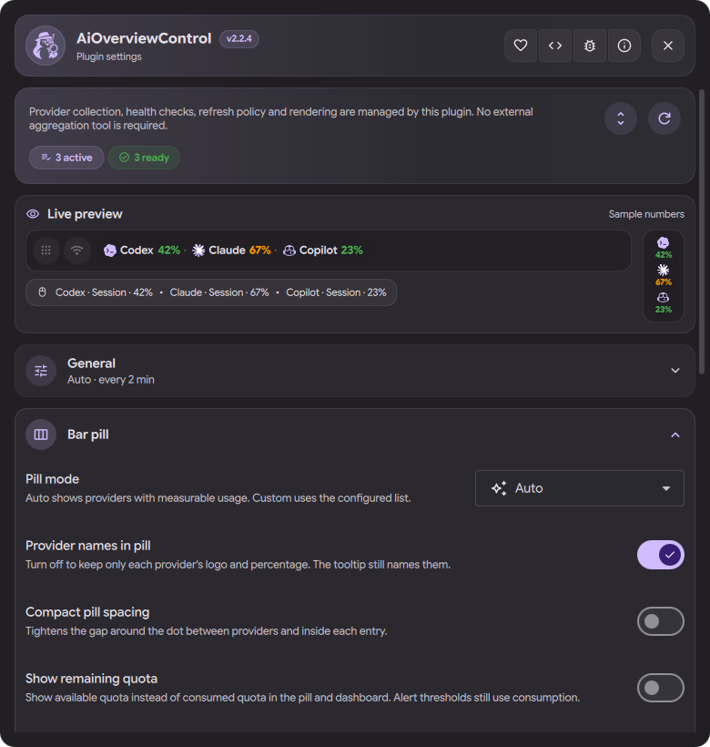

# 2.3.0: Grok Bot, keyring keys and a settings page with a live preview

This feature release for Dux Shell 2.0 and 2.1 adds the **Grok Bot** provider
(44 in the catalog), lets API keys stay in the desktop keyring, and makes the bar
pill say what an account can actually use: a used-up weekly limit takes over the
bar, and a prepaid balance reads as an amount. The settings page is rebuilt
around foldable groups and a live preview of the bar pill. OpenCode Go and
Antigravity read their current data again, readiness details are translated,
and shell statement coverage reaches 100%.

Settings, Claude profiles, pins and history carry over unchanged. Version
authority remains `plugin.json`; the published release body comes from the
matching section in `CHANGELOG.md`.

<p align="center">
  
</p>

## Contents

- [Upgrading](#upgrading)
- [New provider: Grok Bot](#new-provider-grok-bot)
- [API keys from the desktop keyring](#api-keys-from-the-desktop-keyring)
- [The bar pill](#the-bar-pill)
- [Settings page](#settings-page)
- [Provider fixes](#provider-fixes)
- [Translations](#translations)
- [Documentation](#documentation)
- [Maintenance and security](#maintenance-and-security)
- [Validation and limitations](#validation-and-limitations)
- [Thanks](#thanks)

## Upgrading

- Requires Dux Shell 2.0 or newer; 2.1 is tested. DMS 1.6 users stay on
  [1.22.0](https://github.com/bernardopg/AiOverviewControl/releases/tag/v1.22.0).
- The manifest kept its shape, so a plugin reload picks up the adapters and the
  bar. The settings window is cached by the running shell: run `dms restart` once
  to see the new settings page.
- One default changed: a provider without a **Bar usage window** choice now uses
  **Automatic** (see [The bar pill](#the-bar-pill)). To keep the previous
  behaviour for a provider, pick **Primary** for it.
- Nothing else needs a decision. Grok Bot and the keyring route are off until you
  enable them.

## New provider: Grok Bot

([#109](https://github.com/bernardopg/AiOverviewControl/pull/109))

| Provider | Credential | Shows |
| --- | --- | --- |
| [Grok Bot](../providers.md#grok-bot-xai-agent-app) (`grokbot`, alias `grok-bot`) | Sign-in of the Grok Bot desktop app | The weekly Grok Bot Plan pool and its reset time |

- The card reads the signed-in session from the app's own files, decrypts the
  token in memory and sends it only to the app's usage endpoint, through a
  `curl --config` pipe.
- When the request fails, the card serves the app's own saved reading with the
  time the app fetched it, so the bar fades it as stale instead of guessing.
- On a desktop with a Secret Service, Electron keeps the session key in the
  keyring. The plugin does not read that key: the card then shows the app's saved
  reading, or says to start Grok Bot with `--password-store=basic`, and readiness
  reports the same instead of **Ready**. See
  [Troubleshooting](../troubleshooting.md#grok-bot-says-its-session-key-is-in-the-desktop-keyring).
- `GROKBOT_CONFIG_DIR` and `GROKBOT_API_URL` are documented in
  [Configuration](../configuration.md#environment-variables).

## API keys from the desktop keyring

([#105](https://github.com/bernardopg/AiOverviewControl/pull/105))

Dux Shell runs as a user service, so a key exported in `~/.bashrc` never reaches
it. OpenRouter, Z.ai, GLM and OpenCode Go can now read their key from the
freedesktop keyring at the moment of use:

```bash
secret-tool store --label="OpenRouter quota" service openrouter username quota
# in ~/.config/environment.d/90-dms.conf, then restart the shell:
AIOC_VAULT_OPENROUTER="service openrouter username quota"
```

| Variable | Card |
| --- | --- |
| `AIOC_VAULT_OPENROUTER` | OpenRouter |
| `AIOC_VAULT_ZAI` | Z.ai |
| `AIOC_VAULT_GLM` | GLM |
| `AIOC_VAULT_OPENCODE` | OpenCode Go |

- The variable holds only the lookup words, not the key. An exported key still
  wins.
- A background refresh never raises an unlock prompt. The adapter first asks the
  Secret Service whether the entry is unlocked (`SearchItems`, which does not
  prompt) and skips a locked one. `AIOC_VAULT_TIMEOUT` (default 3 s) bounds any
  other lookup, and readiness never touches the keyring.
- The spec is split without glob expansion and must be attribute/value pairs.
  Details in [Keys from the keyring](../configuration.md#keys-from-the-keyring).

## The bar pill

### A used-up window takes over

([#106](https://github.com/bernardopg/AiOverviewControl/pull/106))

A Codex or Claude account blocked by its weekly limit used to show its idle 5 hour
window: 0% used, or 100% left in green. Without a **Bar usage window** choice,
the bar and the card header now show the primary window unless a later window
is used up while the primary still has room.

| Windows | Bar before | Bar in 2.3.0 |
| --- | --- | --- |
| 5h 0%, weekly 100% | `0%` | `100%` |
| 5h 42%, weekly 81% | `42%` | `42%` (only exhaustion promotes a window) |

- The new **Automatic** option in **Bar usage window** is the default;
  **Primary** keeps the primary window.
- Sorting, the hero, the fleet rollup and history keep the primary window, so
  their series keep their meaning.

### Prepaid balances read as amounts

([#107](https://github.com/bernardopg/AiOverviewControl/pull/107))

A prepaid balance has no total to measure against, so the bar read "100% left"
for any balance. The bar pill, its tooltip and the card header now show the
amount: `$95.50`, `¥9.34`.

- Adapters mark these windows with `isBalance`: DeepSeek, Kimi, xAI prepaid
  credits, Cline, Ollama Cloud purchased credits and Vercel AI Gateway.
- DeepSeek amounts carry the currency symbol and two decimals (`¥9.34`, not
  `CNY 9.34`).
- The contract is documented in
  [Architecture](../architecture.md#provider-contract).

## Settings page

([#113](https://github.com/bernardopg/AiOverviewControl/pull/113))

The page was one flat list, about 4,100 px tall, with every option under a single
"Interface" heading. It is now:

- **Live preview.** A preview at the top draws the bar pill the way the bar
  does, with a vertical bar beside it and the hover tooltip under it, from sample
  numbers. It follows every bar setting as you change it: pill mode, names,
  spacing, remaining quota, the tooltip and each provider's window.
- **Foldable groups.** General, Bar pill, Dashboard, Notifications, Providers,
  Claude profiles, History and data, and Diagnostics. A folded group shows a
  one-line summary (`Custom · 3 in the bar`), and one button expands or
  collapses them all. The page is about 1,900 px tall with **Bar pill** open.
- **Inside the groups.**
  - The provider grid has a search field.
  - Long explanations sit behind **How it works**.
  - Notification options fold under their switch.
  - Claude profiles are cards with a remove button.
  - The logo color can return to the theme accent.
  - Dropdowns are wide enough for their labels.

Every stored setting still has a control; the runtime test checks that. See
[Usage](../usage.md#settings-window).

## Provider fixes

| Provider | Change | PR |
| --- | --- | --- |
| OpenCode Go | Reads the endpoint's nested `usage.rolling` / `percent` / `resetsAt` envelope, so the 5 hour, weekly and monthly windows are back; the older flat envelope still parses | [#104](https://github.com/bernardopg/AiOverviewControl/pull/104) |
| Antigravity | While the app runs, its local language server answers for the account it is signed in to, including the Gemini pool the cloud endpoint can leave out; other accounts keep their cloud numbers | [#108](https://github.com/bernardopg/AiOverviewControl/pull/108) |
| Antigravity | A pool whose remaining fraction is omitted reads as used up; the Gemini 4 Argon pool and Chinese window names are recognised | [#108](https://github.com/bernardopg/AiOverviewControl/pull/108) |
| Antigravity | Keeps each account's email on systems whose `base64` rejects stray padding (Ubuntu 26.04 with uutils coreutils) | [#108](https://github.com/bernardopg/AiOverviewControl/pull/108) |
| Antigravity | Account windows show the reset countdown next to a bare percentage | [#108](https://github.com/bernardopg/AiOverviewControl/pull/108) |
| Claude | The LiteLLM pricing table is never moved into a directory occupying the cache path | [#111](https://github.com/bernardopg/AiOverviewControl/pull/111) |
| Codex | An app-server that ignores SIGTERM is killed instead of waited on | [#111](https://github.com/bernardopg/AiOverviewControl/pull/111) |

The Antigravity language server is found by its executable, contacted on loopback
only, and its token stays off the command line; `ANTIGRAVITY_NO_LOCAL_RPC=1`
turns it off. See [Security](../security.md#what-you-can-expect).

## Translations

([#112](https://github.com/bernardopg/AiOverviewControl/pull/112),
[#114](https://github.com/bernardopg/AiOverviewControl/pull/114))

- The readiness detail in Settings (what a provider is missing) is translated in
  every language instead of always showing English. `tests/test-i18n.sh` fails
  when a new detail has no translation.
- Brazilian Portuguese and German use one term each for the bar pill and for
  providers, and the remaining English words in Portuguese and Spanish are
  translated.
- Crowdin holds every translated string again, including the dash card terms in
  `translations/`. A **Crowdin sync** workflow uploads the bundles on every merge
  and fails, without overwriting, when Crowdin holds a translation the
  repository lacks. See [Translations](../i18n-crowdin.md).

## Documentation

- The README shows a **coverage** badge and describes the 2.3 features, in
  English and Portuguese, with a new screenshot of the settings window.
- New or rewritten: [Keys from the keyring](../configuration.md#keys-from-the-keyring),
  the [Grok Bot provider section](../providers.md#grok-bot-xai-agent-app), the
  [settings window](../usage.md#settings-window), the
  [Crowdin workflow](../i18n-crowdin.md), and how to keep a multi-line shell
  command measurable in [Development gates](../development-gates.md#statement-coverage).
- The README contributor grid credits [@alvorithm](https://github.com/alvorithm)
  and [@DotRedstone](https://github.com/DotRedstone)
  ([#110](https://github.com/bernardopg/AiOverviewControl/pull/110)).

## Maintenance and security

- **Coverage.** Shell statement coverage goes from 98.0% to 100% (2,333
  statements), and the **Statement coverage** gate rises from 95% to 97%
  ([#111](https://github.com/bernardopg/AiOverviewControl/pull/111)). New tests
  cover a stuck Codex app-server, the exchange-rate lock, the LiteLLM pricing
  cache, Antigravity CLI token errors, xAI renewal rejections and a stray release
  archive entry; dead code was removed.
- **Coverage badge.** The README badge reads `docs/badges.json`, and the coverage
  job fails when that number no longer matches the measurement.
- **Binary artifact.** A compiled Python file committed with the coverage work is
  removed; `__pycache__/` is ignored and `scripts/check-metadata` rejects tracked
  bytecode. OpenSSF Scorecard had flagged it.
- **New suites:** `tests/test-grokbot.sh`, `tests/test-vault-keys.sh`,
  `tests/test-claude-pricing.sh` and `tests/test-crowdin-drift.sh`.

## Validation and limitations

- Every shell suite, the QML runtime suite under the pinned Dux Shell, the
  metadata, changelog and coverage gates and the fuzz harnesses pass in CI.
- **Verified live:**
  - The keyring route against a real Secret Service.
  - The Antigravity local server with two signed-in accounts, each keeping its
    own numbers.
  - The Crowdin sync against the live project.
- **Fixture-tested only:**
  - **Grok Bot:** no install was available. Please report a card that disagrees
    with the app's **Usage & Billing** page.
  - **OpenCode Go:** the new envelope comes from a captured live response.
- kcov does not list part of `providers/get-provider-usage`: its parser loses
  track of quotes at a multi-line jq program. The 100% figure covers what kcov
  lists; [TODO.md](../../TODO.md) tracks the rest.

## Thanks

- [@alvorithm](https://github.com/alvorithm) tracked down the OpenCode Go envelope
  change and wrote the keyring route
  ([#103](https://github.com/bernardopg/AiOverviewControl/pull/103),
  [#102](https://github.com/bernardopg/AiOverviewControl/pull/102)).
- [@DotRedstone](https://github.com/DotRedstone) wrote the Grok Bot provider, the
  used-up window and balance pill, and the Antigravity local server path
  ([#101](https://github.com/bernardopg/AiOverviewControl/pull/101)).
